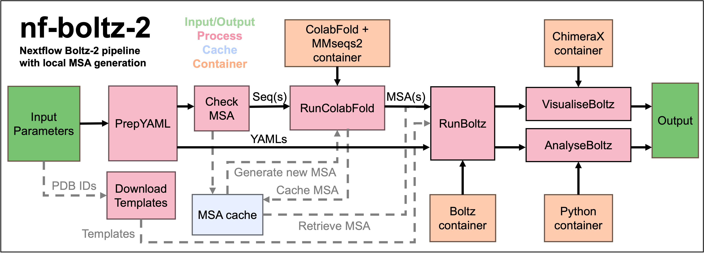

# nf-boltz-2

A robust, scalable pipeline to run **Boltz-2** structure predictions with advanced complex modeling, ligand support, and structural constraints, with local multiple sequence alignment (MSA) using [Nextflow](https://www.nextflow.io/).



## Introduction

**nf-boltz-2** orchestrates Boltz structure prediction, handling input preparation, resource management, sequences/ligands complexity, and advanced configuration for constraints and templates.

- Fast setup of complex protein, DNA, and RNA systems.
- Simple parameter specification; flexible for power users via "extra" fields.
- Supports ligands (by CCD or SMILES), pockets, contacts, templates, and batch runs.

Upstream Boltz: https://github.com/jwohlwend/boltz

## Setup

This pipeline runs every step in an Apptainer/Singularity container - nothing needs to be
installed on the host besides [Nextflow](https://www.nextflow.io/) and Apptainer itself.

### 1. Build the containers

```
apptainer build boltz2.sif apptainer/boltz2.def
apptainer build boltz2-lowmem.sif apptainer/boltz2-lowmem.def   # optional, for large/low-memory GPU jobs
apptainer build colabfold.sif apptainer/colabfold.def
apptainer build python_tools.sif apptainer/python_tools.def
```

ChimeraX is free for non-commercial/academic use but its `.deb` cannot be redistributed here.
Agree to the license and [download ChimeraX for Ubuntu 24.04](https://www.cgl.ucsf.edu/chimerax/download.html)
into `apptainer/`, then build:
```
apptainer build chimerax.sif apptainer/chimerax.def
```
Set `--enable_visualisation false` if you don't want to build/use this container.

By default the pipeline looks for these `.sif` files in the repository root
(`boltz2_container`, `colabfold_container`, etc. in [nextflow.config](nextflow.config)).
Override with `--boltz2_container /path/to/boltz2.sif` etc. if you keep them elsewhere.

### 2. Boltz-2 model weights

`boltz predict --cache <dir>` downloads model weights automatically into `boltz2_models` on
first run if the directory is empty, so no manual step is required - just make sure the path
(default `./boltzmodels`) is writable and has network access on first run.

### 3. ColabFold sequence databases (for MSA generation)

MSA generation runs `colabfold_search` against local MMseqs2 databases. Edit
[setup_colabfold_databases.sbatch](setup_colabfold_databases.sbatch) (`WORK_DIR`, `CONTAINER`,
and SLURM resource directives) for your cluster, then submit it. The databases are large
(several hundred GB) and download/indexing can take many hours. Point `--colabfold_dbs` at
the resulting directory (default `./colabfold_dbs`).

If you don't need MSAs (e.g. `msa: empty` inputs only, or all `seqX_genmsa = false`), you can
skip this step entirely.

### 4. Execution profile

The pipeline ships without an institution-specific executor/scheduler config by default -
pick a profile for your environment:

| Profile      | Use case                                                                 |
|--------------|---------------------------------------------------------------------------|
| `standalone` | Single machine / workstation with a local GPU (local executor, enables Apptainer) |
| `slurm`      | Generic SLURM cluster (enables Apptainer + SLURM executor); combine with `--gpu_queue`, `--boltz2_container`, etc. for your site |
| `milton`     | WEHI's Milton SLURM cluster (institutional container/database paths + GPU queue name) |

For other SLURM clusters, use `-profile slurm` and either pass container/database paths as
CLI flags, or copy the `milton` profile block in [nextflow.config](nextflow.config) as a
template for your own site-specific `params` overrides.

## Quick Start

Clone this repository, complete [Setup](#setup) above, then run:

    nextflow run main.nf --pred_name my_example --outdir ./results -profile standalone

> By default, the system expects sequences/ligands defined via pipeline parameters.
> Alternatively, you may provide a completed YAML file via `--input_yaml` (see [YAML input mode](#yaml-input-mode) below).


## Input Parameters

All parameters can be provided as Nextflow CLI flags (e.g. -params-file, or individually with --X value).

### Main Input/Output

| Parameter   | Description                                            | Default              |
|-------------|--------------------------------------------------------|----------------------|
| pred_name   | Run name (letters, numbers, _, -)                      | test                 |
| outdir      | Output directory                                       | boltz2                |
| input_yaml  | Optional: YAML file/dir with pre-configured input      | null                 |

### Sequences (Proteins / DNA / RNA)

Supports **up to 4 main ("explicit") sequences** plus additional ones using "extra" string block format.

For each of 4 explicit entries (`seq1`...`seq4`):

- `seqX_type`       — Must be `protein`, `dna`, or `rna`
- `seqX_chain_id`   — Chain ID(s), e.g. 'A' or 'A,B'
- `seqX_seq`        — Single-letter sequence
- `seqX_mod`        — Optional, modifications as `[RESIDX,CCD]...` blocks, e.g. `[10,SEP][55,PTR]`
- `seqX_cyclic`     — true if cyclic (rare; usually false). Emits `cyclic: true` in the Boltz-2 YAML.
- `seqX_genmsa`     — true for MSA generation (default for protein); false skips MSA (`msa: empty`)
- `seqX_msa_csv`    — Path to a pre-existing MSA CSV file, skips MSA generation for this sequence
- `seqX_start_index`— Starting residue index (default: 1) for partial sequences; modifications and constraints use real biological numbering and are auto-adjusted for Boltz-2, then converted back in outputs/plots

Example:
    seq1_type      = 'protein'
    seq1_chain_id  = 'A'
    seq1_seq       = 'MADSEQYKLV...'

    seq2_type      = 'dna'
    seq2_chain_id  = 'B'
    seq2_seq       = 'ACTGGTTCGA'

For 5 or more sequences, use sequences_extra:
    sequences_extra = '[E][MAAADTESTSEQ] [F,G][CCGUUUAA]'

- Format: [ID(s)][SEQUENCE]
- Chain IDs can be comma-separated for multiple chains.
- Sequence type is auto-detected for extras.

### Ligands (Small Molecules / Ions)

Supports **up to 4 main ligands** plus more using "extra" string block format.

Each of 4 explicit ligands (`lig1`...`lig4`):

- `ligX_chain_id` — Ligand chain IDs (e.g. 'D' or 'D,E')
- `ligX_ccd`      — CCD code (e.g. 'ZN', 'ATP') (optional)
- `ligX_smiles`   — SMILES string (optional; takes precedence over ccd if supplied)

Example:
    lig1_chain_id = 'C,D'
    lig1_ccd      = 'SAH'
    lig1_smiles   = 'CCO'

For 5 or more ligands, use ligands_extra:
    ligands_extra = '[E][ZN][] [F,G][][C1CCCCC1]'

- Format: [ID(s)][CCD][SMILES]
- Either CCD or SMILES required; chain IDs can be comma-separated.
- SMILES containing brackets are supported (bracket-depth parsed, not regex), e.g.
  `'[D][][[Na+]],[E][][CC(=O)[O-]]'`.

### Constraints (Optional)

#### Bond Constraints

- Format: [CHAIN_ID,RES,ATOM][CHAIN_ID,RES,ATOM] ...
- Example: constraints_bond = '[A,33,O][B,1,N] [H,95,SG][L,23,SG]'
- Optional whitespace between the two atoms of a pair is tolerated.

#### Contact Constraints

- Format: Each contact as [CHAIN_ID,IDX/ATOM][CHAIN_ID,IDX/ATOM][DIST][FORCE]
- Example: constraints_contacts = '[A,53][A,57] [A,101][A,130][true]'

#### Pocket Constraints

- Two explicit pockets: constraints_pocket1_binder, constraints_pocket1_contacts, etc.
- More than 2: Use constraints_pocket_extra as space-separated blocks:
  constraints_pocket_extra = "[D][[A,5],[B,12]] [E][[B,99],[C,1]][true]"

### Templates (Optional)

- Up to 2 explicit templates (template1_path, etc.)
- More using template_extra as:
  [PATH][PREDICTION_IDS][TEMPLATE_IDS][THRESHOLD] [PATH2][...]

### Affinity (Optional)

- affinity_ligand_id — Ligand chain ID to use for affinity calculations.
- Additional control over affinity prediction via advanced parameters.

### MSA Generation & Caching

Protein MSAs are generated with ColabFold (see [Setup](#3-colabfold-sequence-databases-for-msa-generation))
and cached by content hash so they're reused automatically across runs/ligand screens sharing
the same protein sequence(s):

- `msa_cache_dir`   — Cache directory (default: `./msa_cache`)
- `use_msa_cache`   — Set `false` to always regenerate MSAs instead of reusing the cache

### Compute and Advanced

- Resources (`boltz2_gpu_model`, `boltz2_cpus`, `boltz2_memory`, `gpu_queue`, etc.) - `gpu_queue`
  and the SLURM `--gres=gpu:<model>:1` syntax only take effect under a SLURM profile (e.g. `milton`).
- Output format: `output_format` = `pdb` (default) or `mmcif`.
- Extra Boltz args (`extra_config`) if needed.

## YAML Input Mode

You can supply a complete, prepared input YAML using --input_yaml.
> In this case, *all other sequence/ligand/constraint/template parameters are ignored*.

For YAML format details, see Boltz documentation:
https://github.com/jwohlwend/boltz/blob/main/docs/prediction.md

## Examples

> All examples below assume an execution profile is appended, e.g. `-profile standalone` or `-profile milton`.

#### Minimal Protein Example

    nextflow run main.nf \
      --pred_name myprot \
      --seq1_type protein \
      --seq1_chain_id A \
      --seq1_seq MVLSPADKTNVKAA...

#### Protein-Ligand Complex (With SMILES)

    nextflow run main.nf \
      --pred_name myligand \
      --seq1_type protein \
      --seq1_chain_id A \
      --seq1_seq MSEQN... \
      --lig1_chain_id E \
      --lig1_smiles '[Na+1]'

#### Complex with Extras

    nextflow run main.nf \
      --pred_name batch \
      --seq1_type protein --seq1_chain_id A --seq1_seq MA... \
      --seq2_type dna     --seq2_chain_id B --seq2_seq ACTGA... \
      --sequences_extra '[F][MGKQHVPTAE...] [K,L][TTAGGG]' \
      --ligands_extra '[X,Y][HEM][] [Z][][C1CCCCC1]'

## Output

- Structure predictions in output directory (PDB/mmCIF).
- JSON or YAML summary of job configuration.
- Optional per-model confidence/PAE/PDE as selected.

## Tips & Troubleshooting

- Explicit sequence types: For seq1–seq4, always specify seqX_type. "Extras" will be auto-detected.
- Chain IDs: must be unique across all sequences and ligands.
- Ligands: Provide SMILES if possible. If both CCD and SMILES are given, SMILES is used.
- Constraints and advanced features: See Boltz constraints documentation and pipeline comments.
- For large/complex jobs: Use -with-dag or -with-report for Nextflow run visualization/reporting.

## References

- [Main Boltz repository](https://github.com/jwohlwend/boltz) [bioRxiv](https://doi.org/10.1101/2025.06.14.659707)
- [Low-memory Boltz-2 implementation](https://github.com/tlitfin/lmi4boltz) [bioRxiv](https://doi.org/10.1101/2025.10.29.684571)
- [Boltz prediction input format](https://github.com/jwohlwend/boltz/blob/main/docs/prediction.md)
- [Nextflow documentation](https://www.nextflow.io/)
- A3M to CSV for Boltz script and ColabFold container definition from Josh Caley (@jscgh) and the[nf-proteinfold](https://github.com/nf-core/proteinfold) project.
- ChimeraX

## Credits

**nf-boltz-2** was originally written by [Joshua Hardy](https://github.com/JoshuaMHardy).
